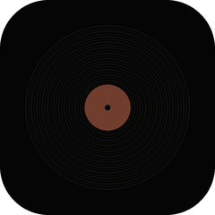

<p align="center">
  
</p>

<h1 align="center">Digital Analog</h1>

<p align="center">
  
  
  
  
  
  <a href="LICENSE"></a>
</p>

<p align="center">
  <a href="#features">Features</a> ·
  <a href="#project-status">Status</a> ·
  <a href="#build">Build</a> ·
  <a href="#tests">Tests</a> ·
  <a href="#repository-structure">Structure</a> ·
  <a href="#usage">Usage</a> ·
  <a href="#license">License</a>
</p>

<p align="center">
  <picture>
    <source media="(prefers-color-scheme: dark)" srcset="assets/divider-dark.svg">
    
  </picture>
</p>

A native iPhone music player for the music you already own. Import DRM-free audio from Files and browse it through an artwork-first, near-black interface with a spatial collection browser, floating search, and a continuous mini-player and full-screen player. Your music, artwork, playlists, and favorites stay on the device for offline listening.

**Stack:** Swift · SwiftUI · AVFoundation · SQLite (portable Swift core package) · MusicBrainz / Cover Art Archive (optional artwork lookup) · Python scripts for project generation

## Features

- Local audio import from Files with duplicate detection and editable metadata (title, artist, album, year, genre).
- Automatic album and cover matching through MusicBrainz and Cover Art Archive, cached covers, embedded artwork, and generated fallback artwork.
- Offline search across your own songs, albums, artists, and playlists, plus mood shortcuts based on your genre tags.
- Albums, artists, playlists, favorites, queue editing, shuffle, repeat, and local text/LRC lyrics.
- Native audio playback, lock-screen media integration, background audio, and AirPlay controls.
- Collection backup and restore with audio integrity checks.
- SwiftUI transitions, interactive collection browsing, artwork-driven lighting, and accessibility accommodations.

> [!NOTE]
> The app has no accounts, subscriptions, telemetry, or media server. The only network use is the optional metadata and artwork lookup for records you have imported.

## Project status

> [!WARNING]
> This is the public local-library edition. On November 21, 2026 it was built for iPhone on GitHub Actions (macOS 15) and passed its tests there: the Swift core suite, 8 simulator tests, the live artwork-provider check and 2 UI journey tests. It has **not** yet been installed on a physical iPhone; signing, long locked playback and measured device performance remain unverified.

## Build

> [!IMPORTANT]
> Requirements: a Mac with Xcode 26+ and the iOS 26+ SDK, Python 3.10+ to generate the project, and an Apple signing identity for installation. The app targets iOS 17+.

```sh
python3 scripts/generate_project.py
open DigitalAnalog.xcodeproj
```

Select the **DigitalAnalog** scheme. Build with Command-B and run tests with Command-U. For an iPhone, choose your signing team, keep a stable bundle identifier, and enable Developer Mode when required.

> [!NOTE]
> There are no prebuilt frameworks or remote packages to fetch; the app depends only on Apple SDKs and the local `Core` Swift package. Windows/Linux can run the portable core tests but cannot build SwiftUI or run Apple's iOS Simulator. See [installation and refresh](docs/INSTALL.md) for signing an IPA through SideStore or other supported tools.

## Tests

With a Swift toolchain and SQLite development headers:

```sh
bash scripts/test.sh
```

On Linux, `python3 scripts/test_portable.py --direct` compiles and runs the same core tests without SwiftPM. Logs and a machine-readable summary are written to `Verification/local/`. Neither command verifies an iOS build.

The suites contain 34 Swift core cases (`Core/Tests`), 9 hosted integration cases (`Tests/`), and 2 UI automation cases (`UITests/`). The network-dependent artwork provider test runs separately from deterministic tests. Use [the QA checklist](docs/QA.md) for hardware validation and [the iPhone test guide](docs/IPHONE-TESTING.md) for a first session.

## Repository structure

| Directory | Purpose |
| --- | --- |
| `App/` | SwiftUI screens, playback, search, artwork, and library coordination |
| `Core/` | Portable SQLite persistence, queue state, library search, metadata policy, and tests |
| `Resources/` | Assets and third-party notices |
| `Tests/`, `UITests/` | Native integration tests, fixtures, and UI automation |
| `scripts/` | Project generation and local validation |
| `docs/` | Design, installation, and acceptance procedures |

## CI

> [!NOTE]
> The included workflow has **no push trigger**, and both runner jobs are disabled. Uploading this project will not enable native build jobs. See [CI controls](docs/CI-BUDGET.md) before opting into any hosted runs.

## Usage

Import DRM-free audio through **Collection options → Import audio**. Open search to find songs, albums, artists, or playlists in your collection, or pick a mood to filter by your genre tags. Edit track details, lyrics, or artwork through the record menu; **Find album & artwork** suggests matching releases. Create playlists and manage the queue without leaving the collection canvas.

> [!TIP]
> Export a backup before reinstalling, changing signing identity, or removing the app. Free signing has renewal requirements; offline files do not prevent an expired signature from blocking launch.

## Development timeline

| Date (2026) | Milestone |
| --- | --- |
| September 23 | Development starts |
| November 21 | Source prepared for publication as the public local-library edition |
| Ongoing | Development continues; first native build of this edition and physical iPhone validation pending |

Most development happened locally before publication, so the Git history is short.

## License

MIT; see [LICENSE](LICENSE). Copyright (c) 2026 Mohamed El Yazid El Yaakoubi. Dependency and service notices are in [THIRD_PARTY.md](Resources/THIRD_PARTY.md). Software licenses do not grant rights to music or cover images. Visual-reference imagery is a test-only fixture and is excluded from Release app resources.
